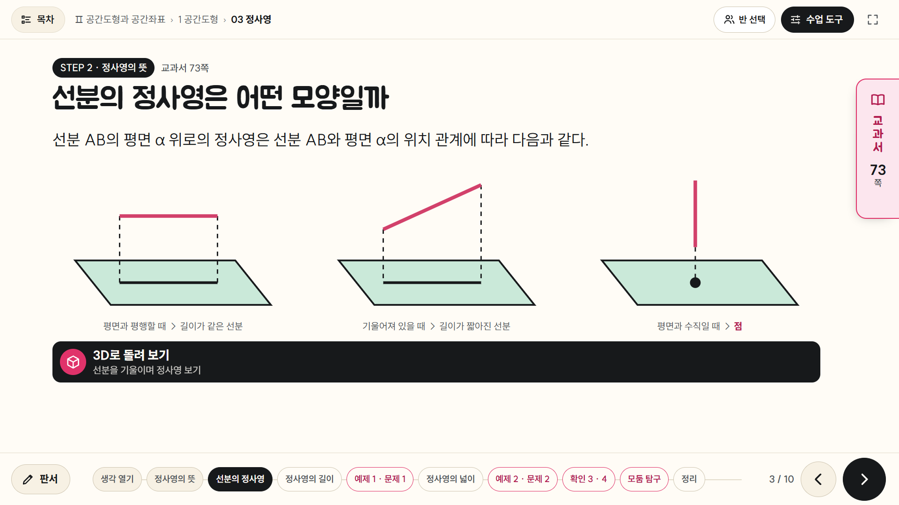
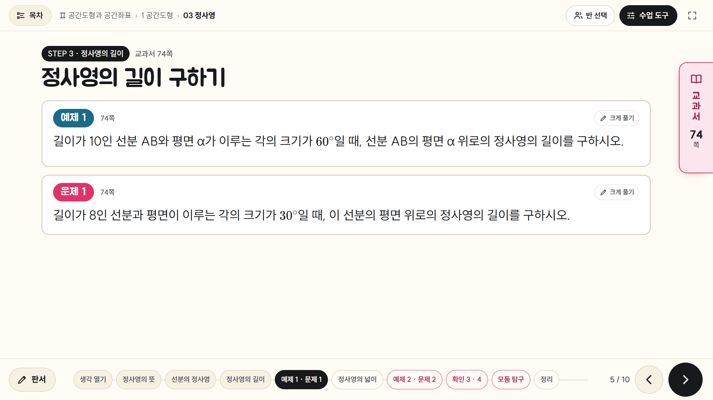
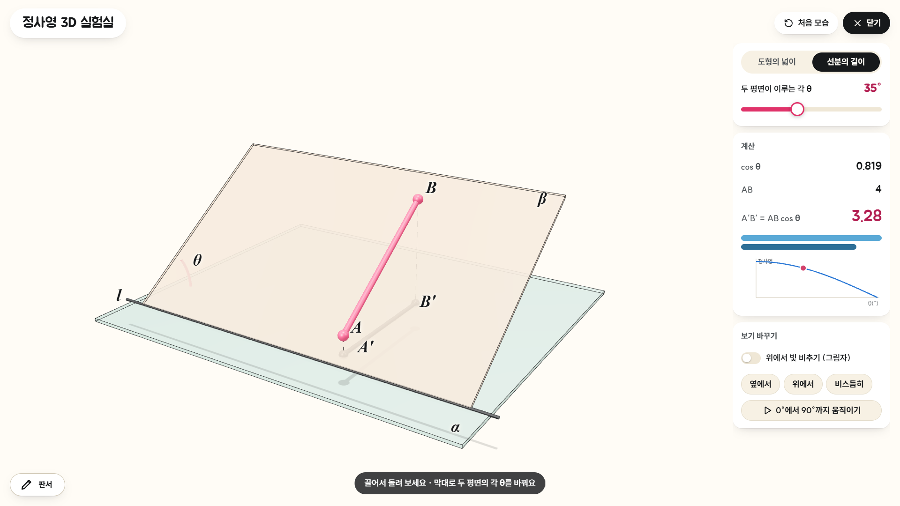
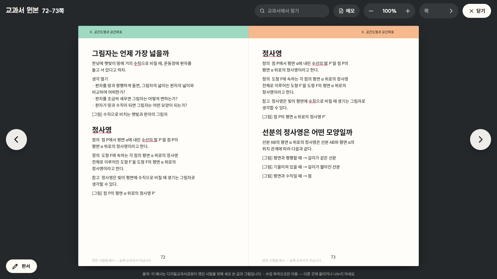
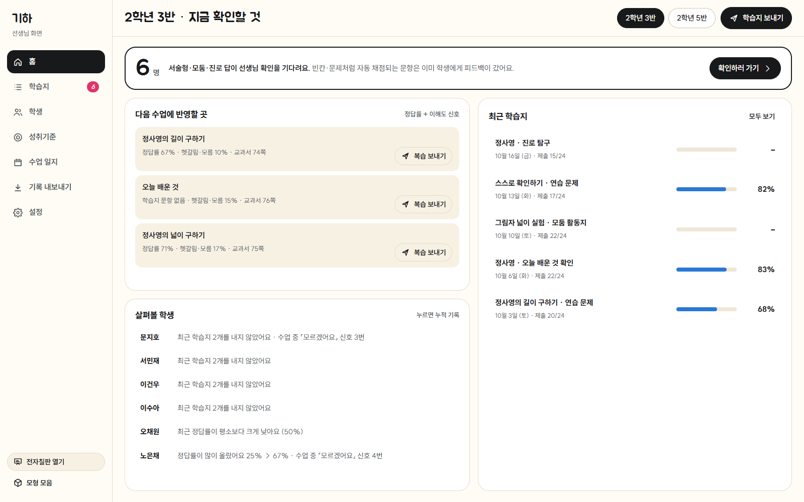
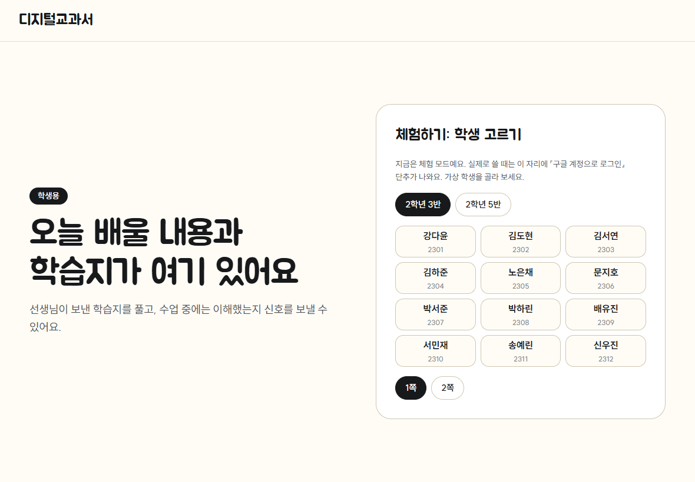
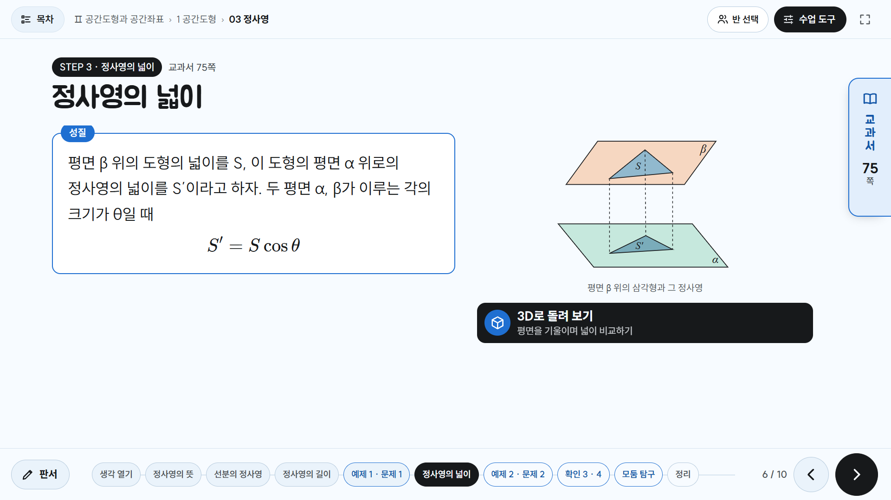

# 디지털교과서공방

교과서 PDF 한 권을 **전자칠판 수업 화면 + 학생 아이패드 학습지 + 선생님 기록 화면**으로 만들어 주는 작업실입니다.
선생님은 **이 저장소 링크와 교과서 PDF만** Claude Code에 넣으면 됩니다. 나머지(설치·화면 만들기·서버 만들기·배포)는 Claude가 합니다.



## 이렇게 시작해요 (처음 한 번)

1. **Claude Code 앱**을 열고 새 대화에 이렇게 적은 뒤, 교과서 PDF를 대화창에 끌어다 놓아요.
   > 이 저장소로 디지털 교과서 만들어 줘: https://github.com/(이 저장소 주소)
2. Claude가 저장소를 받아 필요한 프로그램을 설치하고, **예시 화면**을 보여 주며 이렇게 물어요.
   - 몇 쪽부터 몇 쪽까지 만들까요?
   - 예시와 똑같이 할까요, 바꾸고 싶은 점이 있나요? (테마 색, 3D 모형 많이·적게, 학습지 문항 수, 글자 크기 …)
   - 우리 반 학생 기록까지 쓸까요, 우선 이 PC에서 체험할까요?
3. Claude가 **첫 소단원**을 만들어 보여 줘요. 마음에 들면 「이대로 진행」, 아니면 고칠 점을 말해요.
4. 나머지를 만든 뒤 **서버(Firebase, 무료)를 Claude가 만들어** 링크를 줘요.
   선생님이 하는 일은 **구글 로그인과 「허용」 누르기**뿐이에요.

## 만들어지는 것

| 화면 | 누가 | 하는 일 |
|---|---|---|
| **칠판** (전자칠판) | 선생님 | 교과서 글을 그대로 담은 화면을 넘기며 수업. 판서, 원본 쪽 보기, 3D 모형, 학생에게 묻기, 모둠·발표자·타이머, 화면 테마 7가지 |
| **학생** (아이패드) | 학생 | 학습지(빈칸·문제·모둠·자기평가·진로 탐구), 애플펜슬 필기, 오답 노트, 지난 수업 다시 보기, 내 기록 |
| **선생님 기록** | 선생님 | 학습지 결과, 학생별 누적 기록, 성취기준 도달, 수업 일지, 생기부 근거 내려받기 |

| 칠판 예제 화면 | 3D 모형 | 원본 쪽 보기 |
|---|---|---|
|  |  |  |
| **선생님 기록** | **학생 아이패드** | **테마 (하늘)** |
|  |  |  |

(예시 화면은 엔진 시험용으로 새로 쓴 가상 소단원입니다. 실제 교과서가 아닙니다.)

## 수업에서 쓰기

- **칠판 링크**는 로그인 없이 바로 열려요. 전자칠판 브라우저 즐겨찾기에 넣어 두세요.
- 칠판에서 학생 기능(즉석 질문·학습지 보내기)을 쓰려면 「반 선택」 → **휴대폰 QR로 열기** — 휴대폰으로 찍고 「이 칠판 열기」 한 번이면 한 학기 동안 유지돼요.
- **학생 링크**는 칠판 「수업 도구 › 학생 접속 QR」로 띄우거나 「클래스룸에 올리기」를 눌러요. 학생은 학교 구글 계정으로 들어와요.
- 학생 명단은 선생님 기록 화면 › 설정 › 새 반 › **명렬표 붙여 넣기**(학번·이름·구글 계정) 한 번.
- 다음 단원도 만들고 싶으면 「다음 쪽도 만들어 줘」 — **같은 링크에 이어 붙고**, 이미 나간 학습지와 학생 기록은 그대로 남아요.
- 직접 만든 활동(예: 3D 시뮬레이션, 다른 웹 활동)도 연결할 수 있어요. 칠판·학생 화면에 버튼과 QR이 생겨요.

## 꼭 지켜요 (저작권·개인정보)

- 교과서 PDF와 옮긴 교과서 내용은 **이 저장소에 올라가지 않아요**(`.gitignore`). 각 선생님 PC와, 그 선생님 반 학생만 들어오는 서버에만 있어요.
- 수업 목적으로 우리 반 학생만 보게 해 주세요. 칠판 링크를 반 밖으로 공유하지 마세요.
- 암호가 걸렸거나 복사가 막힌 PDF는 풀지 않아요.
- 학생 기록은 선생님 서버(Firebase)에만 남아요. 학년말에는 백업 후 프로젝트를 지우세요.

## 직접 해 보고 싶다면 (선택)

```
pip install pymupdf pillow playwright && python -m playwright install chromium
```
node(배포용)는 https://nodejs.org LTS. 작업 순서와 규칙은 `CLAUDE.md`와 `.claude/skills/textbook-webapp/SKILL.md`에 있어요.

## 고친 것을 저장소에 올릴 때 (저장소 주인용)

```
python tools/share/check_public.py      # 교과서 내용·계정·열쇠가 섞이지 않았는지 검사 → ✓ 일 때만
git add -A && git commit -m "…" && git push
```
